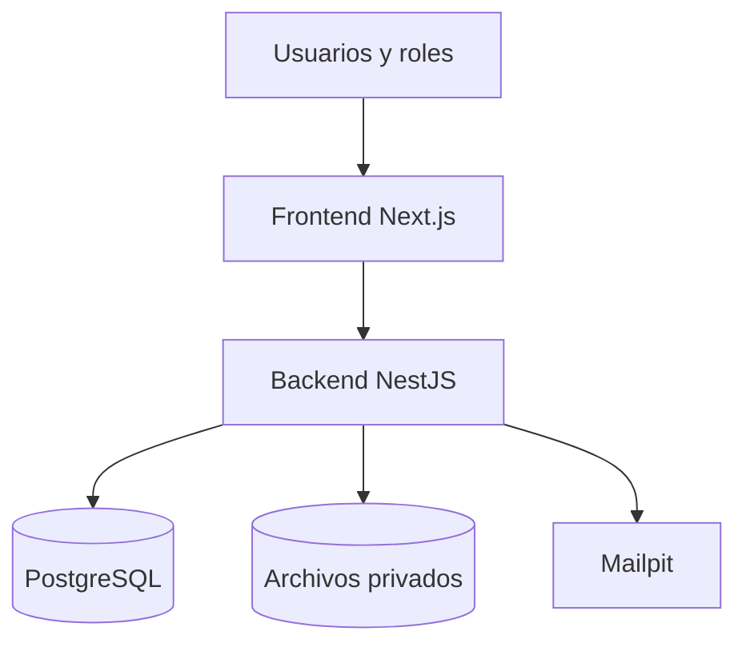

# Arquitectura general

## Propuesta
- Frontend: Next.js + React + TypeScript.
- Backend: NestJS REST API.
- Base de datos: PostgreSQL.
- ORM: Prisma estable compatible.
- UI: Tailwind CSS + shadcn/ui.
- Correo local: Mailpit.
- Reportes: PDFKit/equivalente y ExcelJS.
- Pruebas: Jest y Playwright.
- Entorno: Docker Compose.

URLs propuestas: frontend `localhost:3000`; API `localhost:3001/api/v1`; PostgreSQL `5432`. Confirmar puertos en configuración.
