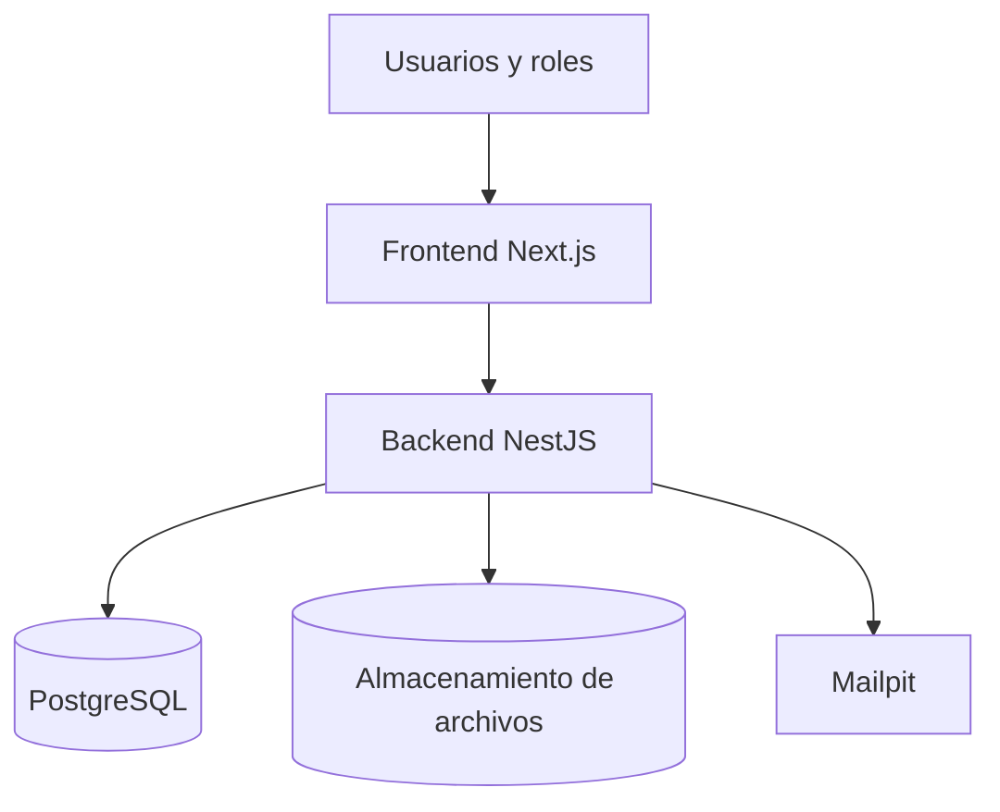

# Arquitectura general

> [!warning] Propuesta por confirmar
> La arquitectura definitiva se documenta después de inspeccionar el repositorio (v0.3 §21.2). Debe separar interfaz, lógica de negocio, persistencia y almacenamiento de archivos.

## Propuesta
- Frontend: Next.js + React + TypeScript.
- Backend: NestJS REST API.
- Base de datos: PostgreSQL.
- ORM: Prisma estable compatible.
- UI: Tailwind CSS + shadcn/ui.
- Correo local: Mailpit.
- Reportes: PDFKit/equivalente y ExcelJS.
- Pruebas: Jest y Playwright.
- Entorno: Docker Compose.

- Los archivos físicos no se guardan en PostgreSQL; el almacenamiento puede empezar local y migrar luego a un servicio externo sin cambiar las reglas funcionales (v0.3 §15.1, §15.7).
- URLs propuestas: frontend `localhost:3000`; API `localhost:3001/api/v1`; PostgreSQL `5432`. Confirmar puertos en configuración.
